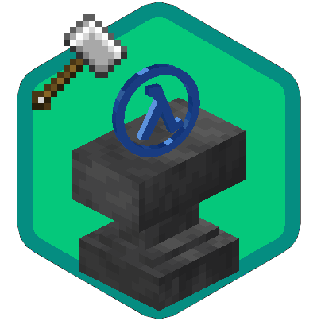

# `ASExtHook`: Plugin to extend Sven Co-op script 

[](https://www.gnu.org/licenses/gpl-3.0)
[](https://github.com/hzqst/asexthook/actions)
[](https://github.com/hzqst/asexthook/releases)
[](https://github.com/hzqst/asexthook/releases)
[](https://github.com/hzqst/asexthook)

`ASExtHook` is a Metamod plugin used to extend the Sven Co-op AngelScripts scripting system.

Using this plugin makes it easy to perform operations that were previously exceptionally difficult, such as hooking whether a monster is dead or not.

Auto-generated HTML documentation for the Sven Co-op AsExtHook Angelscript API is available [Here](https://drabcofficial.github.io/asexthook/)

Used HTML Generator [Here](https://github.com/sven-coop/sven-coop.github.io)

---

<!-- vscode-markdown-toc -->
* 1. [Install](#Install)
* 2. [Build](#Build)
* 3. [Document](#Document)
	* 3.1. [Current Expansion Property](#CurrentExpansionProperty)
	* 3.2. [Current Expansion Objects](#CurrentExpansionObjects)
	* 3.3. [Current Expansion Methods](#CurrentExpansionMethods)
	* 3.4. [Expansion Method Examples](#ExpansionMethodExamples)
	* 3.5. [3.5 Expansion CVar](#ExpansionCVar)
	* 3.6. [Current Expansion Hooks](#CurrentExpansionHooks)
		* 3.6.1. [EntitySpawn](#EntitySpawn)
		* 3.6.2. [IRelationship](#IRelationship)
		* 3.6.3. [MonsterSpawn](#MonsterSpawn)
		* 3.6.4. [MonsterTraceAttack](#MonsterTraceAttack)
		* 3.6.5. [BreakableKilled](#BreakableKilled)
		* 3.6.6. [BreakableTakeDamage](#BreakableTakeDamage)
		* 3.6.7. [BreakableTraceAttack](#BreakableTraceAttack)
		* 3.6.8. [PlayerPostTakeDamage](#PlayerPostTakeDamage)
		* 3.6.9. [PlayerTakeHealth](#PlayerTakeHealth)
		* 3.6.10. [PlayerCallMedic](#PlayerCallMedic)
		* 3.6.11. [PlayerCallGrenade](#PlayerCallGrenade)
		* 3.6.12. [PlayerUserInfoChanged](#PlayerUserInfoChanged)
		* 3.6.13. [GrappleGetMonsterType](#GrappleGetMonsterType)

<!-- vscode-markdown-toc-config
	numbering=true
	autoSave=true
	/vscode-markdown-toc-config -->
<!-- /vscode-markdown-toc -->

---

##  1. <a name='Install'></a>Install

1. Stop the Sven Co-op server and download a complete package from
   [Releases](https://github.com/hzqst/asexthook/releases), or a development
   artifact from [Actions](https://github.com/hzqst/asexthook/actions/workflows/build.yml).
   Packages contain matching x86 builds of Metamod, ASExt and ASExtHook, including
   ASExt gamedata. Extract and merge `build/addons/` into `svencoop/addons/`.
2. Configure `svencoop/liblist.gam` to use
   `gamedll "addons/metamod/dlls/metamod.dll"` on Windows or
   `gamedll_linux "addons/metamod/dlls/metamod.so"` on Linux.
3. Merge the lines for your platform from `addons/metamod/plugins.ini.example`
   into the existing `addons/metamod/plugins.ini`, loading ASExt before ASExtHook.
   Preserve existing plugin entries and server configuration.
4. SQLite uses the game's existing x86 runtime: `svencoop/sqlite3.dll` on Windows
   or `svencoop/dlls/libsqlite3.so` on Linux, relative to the server working
   directory. No separate SQLite library is bundled.
5. Start the server and check `meta list` and the Metamod log for successful
   ASExt/ASExtHook initialization. Compatible ASExt gamedata and game binaries are
   required. Restart the server when replacing native libraries.

The `examples/` files are reference snippets, not automatically enabled plugins.
API HTML documentation is included under `docs/`.

---

##  2. <a name='Build'></a>Build

Requirements: Git, CMake 3.21+, Python 3.8+ (3.12 for repository tests), internet
access for the first dependency/gamedata download, and a 32-bit toolchain.
Windows requires Visual Studio 2022 with Desktop development with C++.
Linux requires GCC/G++ multilib (`gcc-multilib g++-multilib` on Ubuntu).

```sh
git clone --recursive https://github.com/hzqst/asexthook.git
cd asexthook
git submodule update --init --recursive
```

Windows (PowerShell or a developer command prompt):

```sh
cmake -S . -B build/x86/Release -A Win32
cmake --build build/x86/Release --config Release --parallel 4
ctest --test-dir build/x86/Release -C Release --output-on-failure
cmake --install build/x86/Release --config Release
python scripts/package.py --config Release --platform windows
```

Linux:

```sh
cmake -S . -B build/x86/Release -DCMAKE_BUILD_TYPE=Release
cmake --build build/x86/Release --parallel 4
ctest --test-dir build/x86/Release --output-on-failure
cmake --install build/x86/Release
python3 scripts/package.py --config Release --platform linux
```

For Debug, replace every `Release` with `Debug`. Use a separate build tree for
each configuration and platform. The default installation is `install/x86/<Config>`;
an explicit `CMAKE_INSTALL_PREFIX` or `cmake --install --prefix` overrides it.
The packaging script uses the default prefix and writes to `build/packages/`.
Pass `--prefix` and `--build-dir` to the packaging script when using custom trees
(for example, separate Windows and WSL builds in the same checkout).
Visual Studio solutions are generated by CMake inside the build tree.

Metamod and ASExt build from the pinned submodules. Public SDK targets supply
Metamod/HLSDK and the customized AngelScript headers. Transitive dependencies use
recursive submodules or pinned FetchContent revisions. Upstream `*_SOURCE_PATH`
variables can select local dependency clones. ASExt's build downloads, validates
and installs its gamedata; `MMFG_SYNC_GAMEDATA=OFF` requires a previously populated
build tree, and packaging rejects missing gamedata.

### Development checks

```sh
python -m unittest discover -s tests -p "test_*.py" -v
python -m pip install clang-format==23.1.3
cmake -S . -B build/format -DFORMAT_VALIDATION_ONLY=ON
cmake --build build/format --target format-check
# Apply the shared style:
cmake --build build/format --target format
```

The ABI smoke test loads the actual plugin and ASExt dependency, resolves all
SDK-required ASExt exports, and checks plugin exports, SDK negotiation,
function tables and dependency failures with a mock host. It does not execute
game address hooks or replace a test on a real Sven Co-op server.

### CI, releases and upstream updates

- Pushes and pull requests build the triggering source revision on Windows and
  Linux x86 in Debug/Release, run tests and formatting checks, and upload complete
  installation packages. Packages contain exact Git revisions in
  `build/dependencies.json` and dependency notices under `build/licenses/`.
- New tags build both platforms in Release and publish their packages. Release
  uploads can be retried by rerunning the workflow. No release tag is created as
  part of this repository migration.
- `update-upstream.yml` checks daily at 02:17 UTC or manually. It selects ASExt's
  latest published stable Release and Metamod's current `main`, validates the
  exact combination on both platforms, then atomically updates the default branch
  and creates an `asext-release-<release-id>` tag to trigger a release. A moved
  default branch defers the update; API/build failures do not publish.
- Automatic publication requires repository secret `UPSTREAM_UPDATE_TOKEN`, a
  token with Contents read/write permission and access allowed by branch/tag
  rules. Only the publication job receives it. No stable ASExt Release, an already
  handled Release, or a missing secret is a normal no-op. Remove the secret to
  disable automatic writes.

For manual updates, fetch and detach both submodules at the desired commits, run
`git submodule update --init --recursive`, then build and test both platforms
before committing their gitlinks. See [THIRD_PARTY.md](THIRD_PARTY.md) for licenses.

##  3. <a name='Document'></a>Document

###  3.1. <a name='CurrentExpansionProperty'></a>Current Expansion Property
 
|Class|Namespace|Object|
|---|---|---|
|CBinaryStringBuilder|\<Global\>|g_BinaryStringBuilder|

###  3.2. <a name='CurrentExpansionObjects'></a>Current Expansion Objects

```
class HealthInfo{
	CBaseEntity@ pEntity;
	float flHealth;
	int bitsDamageType;
	int health_cap;
}
```

---

###  3.3. <a name='CurrentExpansionMethods'></a>Current Expansion Methods

|Class|Method|Explian|
|---|---|---|
|CEngineFuncs|uint32 CRC32(const string& in szBuffer)|Caculate CRC32 for a string|
|CEngineFuncs|bool ClassMemcpy(?& in src, ?& in dst)|copy class, If src and dst are different type, return false. If not class ref, crash game.|
|---|---|---|
|CBinaryStringBuilder|More info click url👉|[CBinaryStringBuilder](https://drabcofficial.github.io/asexthook/CBinaryStringBuilder.htm)|
|CSQLite|More info click url👉|[CSQLite](https://drabcofficial.github.io/asexthook/CSQLite.htm)|


###  3.4. <a name='ExpansionMethodExamples'></a>Expansion Method Examples

[Example](https://github.com/hzqst/asexthook/tree/main/examples)


###  3.5. <a name='ExpansionCVar'></a>3.5 Expansion CVar

|CVar|default|explain|
|--|--|--|
|sv_fixgmr|1|add gmr found before SV_ModelIndex to fix gmr crash game|

###  3.6. <a name='CurrentExpansionHooks'></a>Current Expansion Hooks

---

####  3.6.1. <a name='EntitySpawn'></a>EntitySpawn

```
Hooks::Entity const uint32 EntitySpawn (CBaseEntity@ pEntity)
```

Call after original CBaseEntity::Spawn called.

StopMode: CALL_ALL

MapScript | Plugin

---

####  3.6.2. <a name='IRelationship'></a>IRelationship

```
Hooks::Entity const uint32 IRelationship (CBaseEntity@ pEntity, CBaseEntity@ pOther, bool param, int& out newValue)
```

Pre call before checking relation.

if newValue changed, will use new relationship.

StopMode: CALL_ALL

MapScript | Plugin

---

####  3.6.3. <a name='MonsterSpawn'></a>MonsterSpawn

```
Hooks::Monster const uint32 MonsterSpawn (CBaseMonster@ pMonster)
```

Call after who having FL_MONSTER entity CBaseEntity::Spawn called.

StopMode: CALL_ALL

MapScript | Plugin

---


####  3.6.6. <a name='MonsterTraceAttack'></a>MonsterTraceAttack

```
Hooks::Monster const uint32 MonsterTraceAttack (CBaseMonster@ pMonster, entvars_t@ pevAttacker, float flDamage, Vector vecDir, const TraceResult& in ptr, int bitDamageType)
```

Call before origin CBaseMonster::TraceAttack called.

StopMode: CALL_ALL

MapScript | Plugin

---


####  3.6.7. <a name='BreakableKilled'></a>BreakableKilled

```
Hooks::Entity const uint32 BreakableKilled (CBaseEntity@ pBreakable, entvars_t@ pevAttacker, int iGib)
```

Call before origin CBreakable::Die called.

StopMode: CALL_ALL

MapScript | Plugin

---

####  3.6.8. <a name='BreakableTakeDamage'></a>BreakableTakeDamage

```
Hooks::Entity const uint32 BreakableTakeDamage (DamageInfo@ info)
```

Call before origin CBreakable::TakeDamage called.

StopMode: CALL_ALL

MapScript | Plugin

---

####  3.6.9. <a name='BreakableTraceAttack'></a>BreakableTraceAttack

```
Hooks::Monster const uint32 MonsterTraceAttack (CBaseEntity@ pBreakable, entvars_t@ pevAttacker, float flDamage, Vector vecDir, const TraceResult& in ptr, int bitDamageType)
```

Call before origin CBreakable::TraceAttack called.

Notice that player died will call this hook, because player is monster too.

StopMode: CALL_ALL

MapScript | Plugin

---

####  3.6.10. <a name='PlayerPostTakeDamage'></a>PlayerPostTakeDamage

```
Hooks::Player const uint32 PlayerPostTakeDamage (DamageInfo@ info)
```

Call after origin CBasePlayer::TakeDamage called.

StopMode: CALL_ALL

MapScript | Plugin

---

####  3.6.11. <a name='PlayerTakeHealth'></a>PlayerTakeHealth

```
Hooks::Player const uint32 PlayerTakeHealth (HealthInfo@ info)
```

Call after origin CBasePlayer::TakeHealth called.

StopMode: CALL_ALL

MapScript | Plugin

---

####  3.6.12. <a name='PlayerCallMedic'></a>PlayerCallMedic

```
Hooks::Player const uint32 PlayerCallMedic (CBasePlayer@ pPlayer)
```

Call before "Medic!!!!"

StopMode: CALL_ALL

MapScript | Plugin


---

####  3.6.13. <a name='PlayerCallGrenade'></a>PlayerCallGrenade

```
Hooks::Player const uint32 PlayerCallGrenade (CBasePlayer@ pPlayer)
```

Call before "Take Cover!!!!"

StopMode: CALL_ALL

MapScript | Plugin

---

####  3.6.14. <a name='PlayerUserInfoChanged'></a>PlayerUserInfoChanged

```
Hooks::Player const uint32 PlayerUserInfoChanged (CBasePlayer@ pClient, string szInfoBuffer, uint&out uiFlag)
```

Call before player userinfo changed (e.g: name change)

will block original call if uiFlag not 0

StopMode: CALL_ALL

MapScript | Plugin

---

####  3.6.15. <a name='GrappleGetMonsterType'></a>GrappleGetMonsterType

```
Hooks::Weapon const uint32 GrappleGetMonsterType (CBaseEntity@ pThis, CBaseEntity@ pEntity, uint& out flag)
```

Pre call before Weapon Grapple checking monster type

No more hardcoded grapple, yay!

out return value:
|value|result|
|---|---|
|1|pull monster to player|
|2|pull player to monster|
|other|use default|

StopMode: CALL_ALL

MapScript | Plugin

---

####  3.6.16. <a name='SendScoreInfo'></a>SendScoreInfo

```
Hooks::Player const uint32 SendScoreInfo (CBasePlayer@ pPlayer, edict_t@ pTarget, int iTeamID, string szTeamName, uint& out flag)
```

Pre call before sending hud info to edict

will block original call if out value not 0.

StopMode: CALL_ALL

MapScript | Plugin

---
